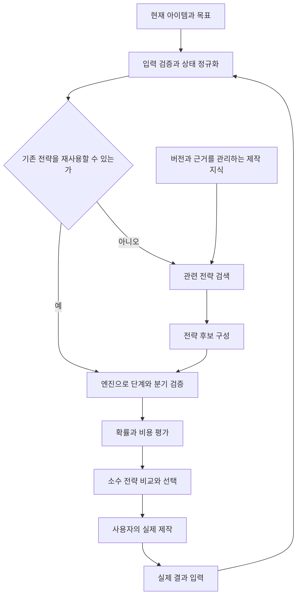

# 제작지원: RAG 기반 동적 제작 전략 설계

상태: **구현 전 설계안**. 확정 요구사항과 구현 제안을 구분한다. 이 문서 추가로 프로그램·제작 규칙·운영 설정이 변경되지는 않는다.

**후속 지시로 좁힌 현재 우선 범위:** 사용자는 전체 제작지원을 새로 구성하기보다 기존 하드코딩된 전략 조건을 먼저 RAG 문서로 옮기고 기존과 같은 동작을 하는지 확인하기로 했다. 추출 결과와 비교 기준은 [기존 전략의 RAG 문서](crafting-support-rag/README.md)를 따른다. 아래의 비용 최적화·새 목표 모델·외부 공략 수집 등 큰 서비스 확장과 §13의 단계 계획은 후속 검토 대상이며 현재 추출 작업의 구현 범위로 적용하지 않는다.

- 작성 기준: 2026-11-16 대화와 코드 `2846ca4b`.
- 목적: 구현 담당자가 대화 전체를 다시 읽지 않아도 서비스 목적, 책임 경계, 기존 제한, 작업 순서와 검증 기준을 이해할 수 있도록 한다.
- 용어 원본: [제작지원 용어](../CONTEXT.md).
- 기존 동작: [자동 탐색](current/automatic-planning.md), [목표 조건](current/goals.md), [사용자 제작 규칙](current/user-crafting-rules.md). 과거 문서의 날짜와 후속 정정 절을 함께 확인한다.
- 이 문서의 **확정**은 사용자 요청, **제안**은 구현 방향, **미결정**은 구현 전에 선택해야 하는 사항이다. 제안을 사용자 승인으로 해석하지 않는다.

## 1. 만들려는 서비스

사용자는 시작 아이템과 목표를 입력한다. 서비스는 가능한 제작 전략을 찾아 몇 개의 유리한 후보로 압축하고, 사용자가 실제로 얻은 결과를 반영해 다음 제작 결정을 돕는다.

주요 고객 요구는 두 가지다.

1. **가성비 아이템**: 스킬 레벨 또는 정신력 등 핵심 조건을 갖추되, 저항·생명력·에너지 보호막 등 나머지 조건에서는 타협한다. 직접 쓰거나 판매할 목적이다.
2. **완성도 높은 아이템**: 여러 옵션에서 타협을 줄인다. 반드시 모든 옵션의 최대 수치만 허용하는 것은 아니다.

출시 목표는 “경로 그림을 한 번 생성한다”가 아니라 **예상과 다른 제작 결과가 나와도 사용자가 다음 행동을 결정할 수 있다**이다. 게임 안의 화폐 사용을 자동 조작하는 서비스는 이 범위에 포함하지 않는다.

## 2. 확정 요구사항과 제안의 경계

| ID | 구분 | 내용 |
|---|---|---|
| R01 | 확정 | 사용자가 시작 베이스/아이템과 목표를 입력한다. |
| R02 | 확정 | 핵심 조건을 갖추는 가성비 목표와 타협이 적은 완성도 목표를 모두 다룬다. |
| R03 | 확정 | 가능한 제작과 불가능한 제작을 구분한다. 근거 없는 불가능 판정은 하지 않는다. |
| R04 | 확정 | 확률이 유리한 후보와 비용이 유리한 후보를 소수 제시한다. 수십 개의 경로를 기본 화면에 나열하지 않는다. |
| R05 | 확정 | 사용자가 경로를 선택해 제작하고, 실제 결과에 따라 중간부터 변경할 수 있게 한다. |
| R06 | 확정 | RAG의 주목적은 제작 전략 지식을 찾아 활용하는 것이다. 자연어 목표 입력은 이번 핵심 요구가 아니다. |
| R07 | 확정 | 현재 구현을 기초로 서비스 만족도와 서버 비용을 함께 고려한다. 제작지원 완성도도 배포 전에 확보한다. |
| R08 | 확정 | 코드 수정에 앞서 설계 문서를 작성한다. 이 문서 작성 작업에서 기능 구현을 시작하지 않는다. |
| P01 | 제안 | 제작 지식 검색·전략 구성·규칙 검증·수치 평가를 분리하고, AI 출력은 검증된 후보로만 승격한다. |
| P02 | 제안 | 목표를 필수·선호·대안 조건으로 표현하고, 중간 보존 조건은 별도로 받는다. |
| P03 | 제안 | 대표 전략 3~5개를 기본 비교 대상으로 삼되, 중복 전략을 제거하고 숫자는 공통 설정으로 관리한다. |
| P04 | 제안 | 목걸이를 첫 검증 대상으로 삼고, 기존 탐색과 RAG 적용 탐색을 동일 조건에서 비교한다. 출시 장비 범위를 목걸이로 확정한 것은 아니다. |
| P05 | 제안 | 실제 게임 제작 안내를 기준으로 검증하며, 사이트 편의 규칙이 섞이지 않도록 규칙 차이를 관리한다. 구체적인 초기 지원 화폐는 별도 확정한다. |

## 3. 사용 흐름과 화면이 전달할 정보

1. 시작 아이템을 선택하거나 실제 게임 복사 텍스트로 가져온다. 베이스·레벨·희귀도·옵션·분열·소켓·품질 등 다음 제작에 영향을 주는 상태를 검증한다.
2. 필수 목표와 대안, 선호 조건을 지정한다. 제작 예산과 보존 조건을 받는 방식은 §14에서 결정한다.
3. 입력 자체의 모순, 계산 가능한 범위, 전략 자료의 적용 버전을 확인한다.
4. 관련 전략을 검색하고 구성한 뒤, 엔진에서 적법성과 결과 분포를 평가한다.
5. 비용·성공 가능성·손실 위험이 다른 대표 전략을 비교한다. 동일한 전략의 사소한 변형을 여러 추천처럼 늘리지 않는다.
6. 사용자가 전략을 선택한다. 다음 행동과 필요한 이유, 성공/실패 시 대응을 보여준다.
7. 실제 결과를 입력받아 현재 상태를 갱신한다. 같은 전략을 계속할 수 있으면 이어가고, 다른 전략이 유리하거나 기존 전략을 따를 수 없으면 재계획한다.
8. 목표 달성, 사용자의 중단, 예산 소진, 더 진행할 수 없는 상태를 구분해 기록한다.

추천 카드에는 비교에 필요한 성공 조건, 확률의 범위/정밀도, 앞으로의 비용, 주요 손실 위험, 가격 기준 시점을 표시한다. 엔진 버전·검색 내부 점수·토큰 사용량 등 운영 정보는 일반 사용자 화면에 나열하지 않는다. 설명이 필요한 오류·자료 부족은 결과를 오해하지 않을 정도로 안내한다.

제안 UI는 기존 제작지원·아이템 카드·화폐 기록·단계 이동을 재사용한다. 결과 입력 방식(텍스트 붙여넣기, 구조화 편집, 후보 선택)은 상태의 관측 가능성에 맞춰 정하며, 미관측 결과를 임의 추첨해 실제 기록에 넣지 않는다.

## 4. 목표와 성공 판정

### 4.1 필수·선호·보존의 분리

- **필수 조건**: 예를 들어 모든 투사체 스킬 레벨 +3 AND 정신력 47 이상. 숫자와 조건의 실제 자격은 현재 카탈로그에서 검증한다.
- **대안 조건**: 예를 들어 사용자가 지정한 서로 다른 저항 중 적어도 두 종류. AND/OR/개수 관계를 보존한다.
- **선호 조건**: 필수 조건을 만족한 결과 중 생명력이나 에너지 보호막이 더 높은 결과를 선호한다. 선호 점수로 필수 미충족을 상쇄하지 않는다.
- **보존 조건**: 현재 특정 옵션을 잃는 행동을 허용하지 않겠다는 별도 제약. 최종 필수 목표라도 중간에 사라졌다가 다시 획득하는 전략은 사용자가 보존을 요구하지 않았다면 검토할 수 있다.

최소 허용 수치와 이상적인 수치를 구분한다. 사용자가 설정한 최소 수치를 AI가 임의로 낮추지 않는다. 완성도/가성비는 같은 목표 모델의 서로 다른 설정으로 다루는 것을 제안하며, 서로 다른 게임 엔진을 만들지 않는다.

### 4.2 정확성 조건

- 목표 행 수와 실제 modifier 수는 다르다. 하나의 복합 속성이 여러 조건을 만족할 수 있으며, 대안 조건의 모든 행을 동시에 요구하지 않는다.
- 접두·접미 자리, 배타 계열, 아이템 레벨, 속성 출처, 고정 상태를 함께 검사한다.
- 수치 조건은 최종 아이템 표시/계산의 공통 규칙을 사용한다. 품질·축성·룬 효과를 별도 산식으로 복제하지 않는다.
- 관측 정보가 부족하면 확정된 내용은 보존하고, 그 정보가 필요한 행동·확률 평가만 제한한다. 원문을 임의 수정하거나 알 수 없는 옵션을 삭제하지 않는다.
- 이미 목표를 만족하면 0회 제작으로 끝내는 후보가 존재해야 한다. 선호 개선을 계속할지는 별도 선택이며 기존 성공을 지우지 않는다.
- 판매 목적은 목표 설정에 반영할 수 있지만, 화폐 시세만으로 판매 가격·거래 속도·수익을 보장하지 않는다. 시장 아이템 가격 수집과 수익 최적화는 별도 범위다.

## 5. 제작 전략을 표현하는 방식

전략 후보는 자유 서술만으로 저장하지 않는다. 아래 의미를 표현하는 버전 있는 구조로 제한한다. 실제 필드명과 API 스키마는 구현 단계에서 확정한다.

| 구성 | 반드시 보존할 의미 |
|---|---|
| 식별과 근거 | 전략 ID·개정, 근거 자료 ID·개정, 적용 게임/규칙 버전, 검증 상태 |
| 입력 변수 | 보호 대상, 획득 대상, 수치 목표, 반복 예산 등. 특정 목걸이 예시를 코드에 고정하지 않는다. |
| 전제 조건 | 베이스·아이템 레벨·희귀도·슬롯·옵션 출처·분열/타락 등 적용 자격 |
| 행동 | 엔진에 등록된 화폐/징조/선택/관측 행동의 ID와 검증 가능한 매개변수 |
| 결과 분기 | 결과 상태 또는 관측한 후보에 따른 다음 단계. 원하는 결과를 확정 행동처럼 다루지 않는다. |
| 반복 | 반복을 계속할 조건, 성공 조건, 비용/횟수 한도, 중단·탈출·재계획 조건 |
| 복구·재시작 | 기존 아이템으로 복구하는지, 새 베이스가 필요한지, 비용·실패 위험은 무엇인지 |
| 종료 | 목표 달성, 사용자 중단, 예산 부족, 검증된 도달 불가, 자료 부족, 계산 미완료 구분 |

실행 시 현재 상태에 대한 자격을 다시 확인한다. 첫 단계가 적법하다고 모든 후속 단계가 적법한 것은 아니다. 임의 코드·수식·URL 실행을 허용하지 않고, 전략에 없는 결과도 원래 아이템 상태를 보존한 채 재계획할 수 있어야 한다.

게임 규칙의 자격, 서비스가 탐색하도록 허용한 행동 범위, 현재 상태에서의 적용 가능성을 각각 구분한다. 정책상 제외한 행동을 “게임에서 불가능”으로 설명하지 않는다.

## 6. 사용자 예시를 검증 사례로 만드는 방법

사용자가 든 예시는 **확정 공략이 아니다**. “투사체 스킬 레벨 +3과 정신력 47 이상을 함께 원할 때, 한 옵션을 분열로 보호한 뒤 다른 옵션을 반복 제작한다”는 전략 유형의 예시다.

후보 A는 투사체 옵션을 먼저 확보·보호하는 방향, 후보 B는 정신력을 먼저 확보·보호하는 방향으로 구성한다. 분열을 사용하지 않는 후보도 같은 조건에서 비교한다. 어떤 후보가 적법하고 유리한지는 계산 전 확정하지 않는다.

각 후보에서 다음을 확인한다.

1. 현재 베이스·레벨에서 목표 수치가 실제로 존재하고 공존할 수 있는가.
2. 첫 핵심 옵션 확보에 필요한 준비 화폐와 실패 결과는 무엇인가.
3. 분열 화폐의 적용 자격을 갖추려면 어떤 준비가 필요한가. 원하는 옵션이 분열될 확률과 다른 옵션이 분열됐을 때의 처리는 무엇인가.
4. 분열 후 남은 속성 중 제거 가능한 것과 보존할 것이 무엇인가. 카오스 반복이 가능한 상태까지 어떤 정리가 필요한가.
5. 엑잘을 준비용으로 사용할 수 있는지, 추가 결과가 바로 성공하거나 후속 자격을 바꾸는 경우가 있는지 확인한다.
6. 남은 목표를 얻는 반복에서 분열·중복 계열·슬롯·레벨·수치 roll을 모두 반영한다.
7. 실패·예산 소진·예상하지 못한 유효 옵션 획득 시 계속하기/전환/중단을 비교한다.

분열을 원하는 옵션에 확정 적용한다고 가정하거나, 분열 직후 카오스 반복의 전제 상태가 저절로 만들어진다고 가정하지 않는다. 단순 `1 - (1 - p)^N`은 매 시도 같은 성공 확률을 갖는 적절한 반복 모델에서만 사용한다. 상태·후속 행동·가격/비용 조건이 달라지는 일반 전략은 결과 분포와 분기로 계산한다.

## 7. RAG와 엔진의 책임

기존 전략으로 계속 진행할 수 있는지 먼저 확인해 불필요한 검색·AI 호출을 줄인다. 재사용한 전략도 실제 상태에서 단계 자격을 확인하고, 비용·확률 평가 역시 일치하는 조건의 캐시가 있으면 활용한다.

| 책임 | 입력과 출력 | 맡기지 않는 일 |
|---|---|---|
| 지식 검색 | 버전·장비·현재 상태·목표 → 관련 전략과 근거 | 게임 규칙이나 확률을 결정 |
| 전략 구성 | 검색 근거·허용 행동 → 검증 가능한 전략 후보 | 수치를 지어내거나 미등록 화폐 실행 |
| 규칙 검증 | 실제 아이템·행동 → 자격, 결과 상태/분포, 미지원 사유 | AI 문장을 근거로 규칙 변경 |
| 전략 평가 | 검증된 전이·목표·예산·가격 → 성공 가능성·비용·위험 | 계산하지 않은 분기를 실패/0% 처리 |
| 진행 관리 | 실제 관측·선택·사용량 → 현재 상태·남은 예산·재계획 | 예상 결과를 실제 제작 기록으로 저장 |

RAG는 지식을 검색해 생성에 제공하는 구성이다. LLM API를 연결하는 것만으로 전략 지식이 확보되지는 않는다. 기존 검증 전략을 그대로 적용할 수 있는 경우에는 LLM 호출을 생략할 수 있다.

### 7.1 지식 수집과 개정

- 게임 공식 자료·PoE2DB·확인 가능한 커뮤니티 공략 등을 조사 대상으로 삼는다. 출처마다 규칙 증거와 전략 경험의 역할이 다르며, 게시됐다는 사실만으로 정확성을 보증하지 않는다.
- 최소 메타데이터는 출처 URL, 제목, 확인 시점, 해당 게임 버전, 핵심 근거 발췌/위치, 장비/메커니즘 태그, 검토 상태, 자료 해시/개정이다. 확인하지 않은 출처는 확인한 것처럼 기록하지 않는다.
- 수집 → 중복 제거 → 버전/적용 조건 분류 → 전략 추출 → 엔진 대조 → 검증된 지식 개정 발행을 구분한다. 외부 문서가 수정됐다고 운영 추천을 즉시 바꾸지 않는다.
- 정확한 ID/태그·키워드 검색과 의미 검색의 조합을 비교한다. 임베딩 모델이나 별도 벡터 DB 도입은 미결정이며 자료 규모·품질·비용을 측정해 선택한다.
- 원문 페이지 하나를 무작정 작은 조각으로 나누지 않는다. 적용 조건·제작 순서·실패 대응을 함께 찾을 수 있는 전략 단위로 구성하고 원문 위치를 연결한다.
- 동일 조건의 상충 자료는 검토 대상으로 남긴다. 오래된 시즌의 공략을 현재 규칙에 자동 승격하지 않는다.
- 출처 접근 조건과 라이선스를 존중한다. 원문 전체를 반드시 서비스 DB/Git에 복제할 필요는 없다. 사용자 원문과 비밀값은 지식 자료로 수집하지 않는다.

### 7.2 신뢰 경계와 장애 대응

검색 자료와 모델 출력은 신뢰하지 않는 입력이다. 자료 안의 명령문을 시스템 지시로 취급하지 않는다. 모델이 지정한 URL·SQL·코드 실행은 허용하지 않는다. 수집 대상·리다이렉트·네트워크 접근 범위를 제한해 임의 내부 주소 접근을 막는다.

구조 검증뿐 아니라 ID 존재·버전·단계 자격·분기 의미·반복 상한을 검사한다. 구조상 유효한 JSON도 제작 규칙상 잘못될 수 있다. 모델에 가격·확률을 작성시켜 공식 수치로 채택하지 않는다.

외부 AI 전송은 정규화된 제작 상태와 필요한 목표로 최소화한다. 계정 정보·세션 이름·자유 글·원문 전체는 기본 전송 대상이 아니다. 공급자의 보관/학습 정책과 운영 키 관리는 모델 선택 시 확정한다.

AI 실패·시간 초과·비용 한도 도달 시 이미 검증된 후보와 기록을 유지한다. 사용할 후보가 없으면 생성 실패/자료 부족을 구분하며 목표 불가능으로 처리하지 않는다. 복구 재시도에도 횟수와 비용 한도를 둔다.

## 8. 비용·확률·추천 기준

### 8.1 같은 조건으로 비교하기

“싼 전략”과 “확률 높은 전략”은 비교 조건이 있어야 한다. 다음 방식은 **제안**이며 기본 성공률/예산 값은 §14에서 확정한다.

- **성공 가능성 우선**: 같은 현재 아이템·필수 목표·제작 예산·보존 조건에서 예산 안에 목표를 달성할 확률을 비교한다.
- **비용 우선**: 같은 최소 성공 확률을 충족하는 전략의 기대 지출을 비교하거나, 비용과 성공 가능성의 절충 후보를 보여준다. 거의 아무것도 하지 않는 전략이 무조건 “최저가”가 되면 안 된다.
- **보존 우선**: 사용자가 요구한 보존 조건을 만족하는 후보 안에서 비용·확률을 비교한다. 필수 보존 위반을 낮은 가격으로 상쇄하지 않는다.
- 선호 조건은 필수 목표 충족과 함께 평가하되, 좋은 추가 옵션을 얻은 결과의 가치와 계속 제작할 위험을 비교할 수 있게 한다. 선호 점수 산식은 미결정이다.

같은 조건에서 비용·성공 가능성·위험 모두 불리한 후보는 제외할 수 있다. 비용을 보지 않고 단일 행동의 성공률이 높다는 이유만으로 저렴한 후보를 제거하지 않는다. 계산 오차/미해결 범위가 겹치면 순위를 확정한 것처럼 표시하지 않는다.

### 8.2 비용의 의미

계획의 기준 상태, 규칙/지식 버전, 가격 스냅샷을 고정해 재현 가능하게 한다. 현재 리그의 기존 공통 시세 수집·캐시를 재사용하고 추천마다 외부 시세 API를 호출하지 않는다.

| 지표 | 의미 |
|---|---|
| 앞으로의 성공 가능성 | 현재 아이템에서 정한 예산/중단 조건 안에 목표를 달성할 확률 |
| 앞으로의 기대 지출 | 성공·실패·중단 경로 모두의 확률을 반영한 이후 소모량 × 가격 |
| 지출 분포 | 예산을 얼마나 자주 소진하는지, 큰 지출 위험이 있는지. 계산 가능한 범위에서 제공 |
| 이미 사용한 비용 | 실제 사용 기록에 속한다. 다음 전략의 추가 비용과 분리 |
| 성공한 경우의 비용 | 성공 조건부 통계. 전체 기대 지출처럼 표시하지 않음 |

준비 화폐·징조·실패 후 정리·새 베이스 재시작을 빠뜨리지 않는다. 새 베이스 가격이나 특정 재료 가격을 모르면 0으로 처리하지 않고, 입력을 받거나 알려진 비용만 표시해 비교 범위를 제한한다. 기존 아이템의 기회비용·재판매 금액은 포함 여부와 출처를 따로 결정한다. 재시작 기대비용을 무조건 `기대 지출 / 성공 확률`로 계산하지 않는다. 매번 동일한 출발 조건으로 복원되는 등의 가정이 필요하다.

가격이 바뀌면 같은 확률 모델의 재료 소모량에 새 가격을 적용할 수 있다. 그러나 가격 때문에 후보를 잘라냈거나 전략의 다음 행동이 달라지는 경우에는 재평가/재탐색이 필요하다. 기존 순위에 새 가격만 적어 “현재 최저 비용”으로 표시하지 않는다. 이미 지출한 비용의 당시 가격/현재 환산 표시 방식은 별도 확정한다.

### 8.3 계산 결과의 신뢰도

정확한 계산, 수학적으로 보장된 상·하한, 시뮬레이션 추정치를 구분한다. 추정치를 사용한다면 검증된 화폐 전이에서 표본을 생성하고 표본 수·seed·오차/신뢰 구간 산정 방법을 남긴다. 근거 없는 게임 확률을 추정 알고리즘으로 덮지 않는다.

검색되지 않은 전략과 계산되지 않은 분기를 구분한다. 후보 일부를 정확하게 계산해도 전체 최적성이 증명되지는 않는다. 자료 없음, 정책상 미지원, 시간 초과, 표본에서 성공 0회는 “게임에서 도달 불가능”의 증거가 아니다.

## 9. 실제 결과 반영과 저장

- 진행 기록은 실제 상태와 행동, 전략 선택, 사용량을 보존한다. 현재 아이템 revision과 목표 revision을 기준으로 오래된 응답을 폐기한다.
- 같은 관측을 재전송해도 화폐 사용량·진행 단계가 중복 추가되지 않게 한다. 여러 탭에서 오래된 상태를 덮어쓰지 않는다.
- 사용자가 여러 번 제작한 뒤 결과만 입력하면 중간 결과와 실제 소모량을 안다고 가정하지 않는다. 누락 사용량은 별도 입력받거나 미상으로 보존한다.
- 실제 결과로 새로 계산한 성공률은 현재 상태에 대한 조건부 성공률이다. 이전 추천 확률을 기계적으로 곱해 사용자의 실제 기록 확률로 만들지 않는다.
- 목표 변경, 보존 조건 변경, 주요 결과 변화, 규칙 변경 시 재계획한다. 단순 화면 탭 전환·동일 결과 재조회로 AI를 다시 호출하지 않는다.
- 게임/카탈로그 업데이트 후에는 원래 기록과 당시 추천을 읽을 수 있게 한다. 현재 상태의 재검증과 새 규칙으로 다시 계획하기를 분리하고 과거 수치를 덮어쓰지 않는다.
- 익명/계정 저장 범위는 기존 계정 저장 구조를 검토해 확정한다. 현재 Support의 쿠키 소유권·localStorage가 계정 저장과 자동으로 연결된다고 가정하지 않는다.

## 10. 현재 코드에서 재사용할 것과 바꿔야 할 것

아래는 `2846ca4b`의 소스 대조와 앞선 제작지원 검토 결과다. 이 문서 작업에서 기능 테스트를 새로 실행한 결과가 아니다.

| 현재 구성 | 재사용/변경 방향 | 근거 |
|---|---|---|
| 목표 AST와 평가기 | 논리 조건·카탈로그 검증 재사용. 필수/선호/보존 의미를 추가하며 기존 WEIGHTED 조건을 선호 점수로 자동 재해석하지 않음 | [GoalFilter](../backend/src/main/java/com/poe2craft/craftingsupport/goal/domain/GoalFilter.java) |
| 목표 지향 후보 생성 | 현재는 이미 맞춘 행을 보존하고 MATCH 수를 늘리는 방향이 중심. 손실 허용·우회·비용 비교를 위한 후보 생성으로 확장 | [GoalDirectedPlanner](../backend/src/main/java/com/poe2craft/craftingsupport/search/domain/GoalDirectedPlanner.java) |
| 확률이 높은 추가 후보 우선 | `preferAddition`에서 시세 없이 일반 화폐 후보를 제거할 수 있음. 비용 목표를 추가할 때 해당 가지치기를 검토 | 위 `GoalDirectedPlanner` |
| 적응적 도달 확률 평가 | 결과 분포와 미해결 질량 처리 재사용. 제작 예산·소모량·선호 평가를 붙이는 설계 필요 | [CertifiedOutcomeStrategy](../backend/src/main/java/com/poe2craft/craftingsupport/search/domain/CertifiedOutcomeStrategy.java) |
| 자동 화폐 정책 | 분열 화폐는 EXCLUDED. 카오스는 시작 단계의 변경 가능한 옵션 획득으로 제한. 신규 전략 허용 범위를 검토해야 함 | [정책 JSON](../backend/src/main/resources/crafting/automatic-currency-policy-v1.json) |
| 분열 상태를 받은 탐색 | 이미 분열된 옵션은 보존하고 첫 변경 가능 옵션에 카오스를 쓰는 경로가 있음. “분열 상태에서 카오스 전부 불가”로 해석하지 않음 | [AutomaticCraftingKernel](../backend/src/main/java/com/poe2craft/craftingsupport/search/domain/AutomaticCraftingKernel.java), [회귀 테스트](../backend/src/test/java/com/poe2craft/bootstrap/AutomaticAbyssSearchTest.java) |
| 품질 작업·사용량 | 재료 사용량 집계는 활용 가능. `WORK:QUALITY_20/40`은 추상 작업이어서 실제 기폭제 종류·수량·효과로 바로 가격 환산 불가 | [AutomaticMethodExecution](../backend/src/main/java/com/poe2craft/craftingsupport/search/domain/AutomaticMethodExecution.java) |
| 현재 시세 | 공통 league·updatedAt·화폐 가격 사용. 제작 규칙과 가격 개정을 분리 | [PriceSnapshot](../backend/src/main/java/com/poe2craft/shared/economy/domain/PriceSnapshot.java) |
| 실제 상태에서 이어가기 | 기존 선택/관측 후 새 탐색 흐름을 재사용하되 예산·전략·기록을 함께 보존하도록 확장 | [AutomaticMethodSearch](../frontend/src/features/crafting/method-search/AutomaticMethodSearch.tsx) |
| 운영 노출 | workbench-production에서는 제작지원 비활성화. 문서/실험 완료만으로 활성화하지 않음 | [운영 프로필](../backend/src/main/resources/application-workbench-production.yaml), [Compose](../infra/compose.workbench.yaml) |

### 10.1 기존 정책과 새 서비스 요구의 차이

현재 자동 정책은 `approved-187-2026-10-30-strict-exalted-v8`이다. 기존 제외/보류 결정은 실제 게임 규칙과 구분되는 서비스 정책이다.

- 카오스의 시작 조건은 현재 코드상 **분열을 제외한 변경 가능한 속성**을 기준으로 하며 미공개 훼손 슬롯도 개수에 포함한다. 초기 문서의 “실제 explicit 총 1개”만 읽으면 현재 동작과 다르게 이해하게 된다.
- 분열 화폐의 자동 사용, 후반 단계의 카오스 재진입, 일반 엑잘 마무리 등은 새 전략을 구성할 때 검토할 정책이다. RAG 추가를 이유로 모든 제한을 일괄 해제하지 않는다.
- C 엑잘의 옵션 선택이나 사이트 전용 주입기 효과처럼 사용 편의를 위해 바꾼 동작이 존재한다. 실제 게임 추천에는 같은 화폐 ID라는 이유로 해당 전이를 섞지 않는다. [주입기 규칙](../backend/src/main/java/com/poe2craft/shared/crafting/domain/QualityInfuserRules.java)을 포함해 지원 메커니즘별 차이를 확인한다.
- 훼손 관측/선택처럼 현재 정확한 전체 추첨 분포를 모르는 경계는 관측 이후 조건부 안내와 전체 경로 확률을 구분한다. 과거에 선택된 모델/가정을 변경하려면 명시적으로 재검토한다.

### 10.2 RAG에 앞서 해결할 기반 문제

| 문제 | 필요한 작업과 완료 기준 |
|---|---|
| 아이템 JSON 계약 불일치 | `crafted`·`qualityInfused` 등 공통 상태의 생략 기본값, frontend schema, HTTP 입력, 저장 읽기를 정렬. 실제 직렬화 결과의 왕복 검증. 미지원 상태를 조용히 삭제해 통과시키지 않음 |
| 저장 파일 하나가 전체 생성에 영향 | 전체 파일 해석을 통한 중복/활성 작업 조회를 소유자·메타데이터 중심으로 분리. 손상/구버전 자료 한 건 때문에 다른 사용자의 작업이 막히지 않는지 검증 |
| 만료 후 저장 용량 누적 | 계산 체크포인트와 사용자 기록을 분리하고 보존·정리 정책 설계. TTL 만료만으로 디스크가 정리된다고 가정하지 않음. 기존 기록의 무단 삭제 금지 |
| 서비스 전체 잠금·큰 그래프 저장/응답 | 작업별 동시성, 비용 제한, 작은 진행 응답과 선택 상세, 체크포인트 정책 적용. 일반 작업대의 응답성을 보호 |
| 시작 화면 전체 베이스 로딩 | 전체 initial/catalog 동시 요청을 줄이고 registry·선택 항목·공유 카탈로그 캐시 중심으로 로딩 |
| 목표 편집의 중복 계산 | 입력 지연 처리·취소와 버전별 공통 목표 인덱스 재사용. 텍스트 한 글자마다 무거운 탐색/AI 생성 금지 |
| 일부 시나리오 파일의 6개 언어 가정 | ru/th와 기존 6개 언어 저장 파일 호환을 함께 검증. 8개 언어 렌더링에서 없는 카드 접근 방지 |

구체 연결 지점은 [HTTP 입력](../backend/src/main/java/com/poe2craft/craftingsupport/search/api/AutomaticSearchController.java), [공통 기본값](../backend/src/main/java/com/poe2craft/workbench/api/ItemStateWireDefaults.java), [작업 서비스](../backend/src/main/java/com/poe2craft/craftingsupport/search/application/AutomaticSearchService.java), [파일 저장](../backend/src/main/java/com/poe2craft/craftingsupport/search/infrastructure/LocalAutomaticJobRepository.java), [베이스 로딩](../frontend/src/features/crafting/goal-filter/CraftStart.tsx), [시나리오 코드](../frontend/src/features/crafting/method-search/scenarioCode.ts)다.

## 11. 코드 경계와 가변 요소 관리 제안

현재 `craftingsupport/goal`·`search`를 유지하며 실제 책임이 생기는 단위로 분리한다. 아래 이름은 디렉터리/인터페이스 **제안**이며 미리 빈 파일을 만들지 않는다.

| 영역 | 책임 |
|---|---|
| `craftingsupport/knowledge` | 출처·전략 자료 개정·검색·AI 공급자 adapter |
| `craftingsupport/goal` | 목표 검증·성공 판정·선호/보존 조건 |
| `craftingsupport/search` | 전략 후보 구성·검증·평가·계산 작업 수명 |
| `craftingsupport/progress` | 실제 관측·전략 선택·진행 기록·재계획 연결 |
| 기존 shared 제작·아이템·시세 | 공통 게임 규칙·상태·시세. Support 전용 규칙 복제 금지 |

교체될 가능성이 큰 경계는 전략 검색(`StrategyRetriever`), 후보 생성(`StrategyGenerator`), 규칙 검증/전이, 전략 평가, 작업 저장으로 제한한다. 공급자별 HTTP 형식·모델 이름은 도메인 로직에 노출하지 않는다. 전이는 기존 제작 엔진을 adapter로 연결하고 동일 화폐 계산을 새 패키지에서 다시 구현하지 않는다.

변경 원본은 다음처럼 역할을 구분한다. 모든 변수를 의미 없이 한 파일에 합치지 않는다.

- 게임 데이터·효과·가중치: 기존 catalog/crafting 원본과 규칙 identity.
- 자동 탐색 허용 범위: 검토된 단일 정책 원본과 버전. 변경 시 사용자 규칙 원장도 갱신.
- 공통 요청/응답 한도·지원 언어: 기존 `resources/contracts/` 원본과 생성 절차.
- 작업당 후보 수·시간·동시성·캐시·토큰/비용 한도: `backend-settings.yaml`의 의미별 설정. 변수마다 뜻·단위·사용 파일을 주석으로 명시.
- 지식 자료·검색 모델·프롬프트·전략 스키마: 각각 버전을 남겨 재현 가능하게 함. 실제 저장 매체는 §14에서 결정.

시즌 변경 시 원본 갱신 → 영향받는 화폐/전략 식별 → 자료 재검토 → 관련 회귀 → 새 규칙/지식 발행 순서로 진행한다. 이전 계산 기록은 당시 버전의 읽기 경로를 유지하거나 재계산 필요를 명확히 표시한다.

## 12. 요청량·서버 비용·악용 방지

### 12.1 요청과 계산 수명

작업 생성은 중복 방지 키와 입력 revision을 받는다. 서버는 식별자와 초기 결과를 반환하고, 작업 상태·추천 요약과 큰 상세 그래프를 분리한다. 진행 응답은 revision 이후 변경분을 받을 수 있게 설계하며 전송 방식은 폴링/SSE 중 운영 환경과 측정 결과로 결정한다.

준비/대기/실행/부분 결과/완료/일시정지/취소/실패/만료 상태를 구분한다. 클라이언트가 떠난 작업은 lease/유휴 정책에 따라 자원을 반환한다. 브라우저의 취소 요청만 믿고 자원 해제를 결정하지 않는다. 취소·만료 시 개인 기록과 계산용 임시 자료의 보존 규칙은 별도로 적용한다.

대기열·동시 실행·메모리·탐색 상태·벽시계 시간에 한도를 둔다. 외부 AI 호출과 무거운 계산을 전체 서비스 잠금 안에서 실행하지 않는다. 중단 검사는 큰 연산 내부에서도 가능해야 하며 단계 사이에서만 시간 제한을 확인해서는 안 된다.

### 12.2 재사용 범위

| 재사용 대상 | 적어도 구분할 기준 |
|---|---|
| 화폐 전이/옵션풀 | 규칙·카탈로그, 다음 행동의 자격/분포에 영향을 주는 아이템 상태, 화폐·징조 |
| 검색 자료 | 지식 개정·적용 버전·장비·메커니즘·목표 의미, 검색기 개정 |
| 전략 후보 | 지식/생성기/스키마 개정·시작 상태 조건·목표·허용 행동·보존 조건 |
| 전략 평가 | 검증된 후보·확률 모델·목표·제작 예산·중단 조건·가격 기준·평가기 개정 |
| 사용자 진행 | 소유자·실제 상태/목표 revision·전략 선택·사용량. 공용 캐시에 섞지 않음 |

아이템 상태를 압축해 재사용하려면 목표 판정과 모든 후속 행동의 자격·분포가 같음을 검증한다. 옵션 개수나 목표 MATCH 개수만 같다고 동일 상태로 합치지 않는다. 크기 제한·만료·중복 실행 합치기를 함께 적용한다.

AI는 전략 생성이 필요한 순간에 호출한다. 같은 전략으로 카오스를 여러 번 반복하는 동안 매번 호출하지 않는다. 지식 검색 횟수, 생성 호출 횟수, 엔진 평가 횟수는 별도로 측정한다.

### 12.3 비용 제한과 운영 지표

기존 [보안 문서](security.md)의 요청 제한과 본문 제한을 재사용하고, 제작지원의 무거운 작업/AI 호출에는 별도 작업 한도를 적용한다. 일반 작업대 트래픽과 실행 자원을 분리해 검색 폭주가 제작 클릭을 막지 않게 한다.

- 계정/익명 사용자·IP 보조 제한, 전체 동시성/대기열 제한, 작업별 상한, 전역 AI 지출 한도를 함께 적용한다. IP 하나를 한 사람으로 확정하지 않는다.
- 외부 호출 전 예산을 예약하고 완료 후 정산해 동시 요청이 비용 한도를 우회하지 않게 한다. 타임아웃/재시도도 이미 발생한 공급자 비용을 고려한다.
- 생성된 작업·진행 기록·원본 자료의 읽기/수정 권한을 검사한다. 사용자별 응답을 공용 캐시 키로 노출하지 않는다.
- 운영 지표: 첫 유효 추천 시간, 최종 응답 시간, 캐시 적중, 후보 생성/기각 이유, 성공/미완료 비율, 계산 CPU·메모리·디스크, 요청/응답 바이트, AI 토큰·비용, 취소 후 자원 반환 시간.
- 로그에 개인 원문·전체 프롬프트·비밀값을 기본 기록하지 않는다. 전략/규칙/자료 개정과 비식별 진단값으로 재현한다.

## 13. 구현 순서와 단계별 완료 기준

아래는 커밋을 나눌 **계획**이다. 각 단계의 크기가 커지면 관련 테스트와 함께 더 나눈다. 문서 작성이 다음 단계의 코드 구현 승인이나 운영 활성화는 아니다.

| 순서 | 작업 범위 | 완료 기준 |
|---|---|---|
| 0 | 이 설계와 미결정 사항 정리 | 확정/제안/미결정 구분, 예시와 현재 코드의 차이 확인, 문서 연결 검증 |
| 1 | 기존 Support 입력·저장 호환 복구 | 실제 HTTP/저장 왕복, 생략 기본값/잘못된 타입, 구버전·손상 자료 격리, 현재 상태 보존 |
| 2 | 목표·보존·전략 구조와 규칙 범위 | 필수/선호/대안 판정, 전략 ID/조건 검증, 실제 게임과 편의 규칙 분리, 허용 행동 목록의 명시적 검토 |
| 3 | 작업 수명·지식 개정·검색 기반 | 자원 한도/취소/소유권, 출처와 버전 관리, 알려진 전략 검색, 불일치 버전 차단 |
| 4 | RAG 전략 후보 생성 | 근거 연결, 구조/의미 검증, 잘못된 전략 기각, 주입 공격·장애·비용 상한 검사 |
| 5 | 확률·비용 평가와 대표 후보 | 실패/중단 포함 비용, 알려진 작은 모델과 비교, 가격 변화 시 순위 재평가, 미해결 질량 보존 |
| 6 | 사용자 진행과 재계획 UI | 실제 관측·사용량·중복 요청·여러 탭·목표 변경·새로고침, 기존 공통 UI와 8개 언어 |
| 7 | 기존 탐색과 비교 및 범위 확장 | 대표 사례의 품질/시간/비용 측정, 기존 기능 회귀, 신규 장비/전략 추가 비용 확인 |
| 8 | 배포 전 검수와 활성화 | 정한 출시 범위·부하 기준 충족, 비용 제한·장애 대처·모바일 흐름 확인 후 활성화 판단 |

기존 자동 정책 변경과 RAG 생성기를 한 커밋에서 섞어 결과 차이의 원인을 숨기지 않는다. 단계마다 관련 검사, 남은 한계, 브랜치/커밋을 채팅에 보고한다. 기존 fixture를 새 규칙 기대값으로 덮어쓰기 전에 당시 규칙의 회귀인지 현재 규칙의 검사인지 구분한다.

## 14. 구현 전에 결정할 사항

문서 작성 단계에서는 아래 값을 임의로 확정하지 않는다. 독립적인 기반 결함 수정은 선택이 없어도 계획할 수 있지만, 선택에 종속된 기능은 해당 단계 전에 확인한다.

| ID | 결정 내용 | 제안과 결정 시점 |
|---|---|---|
| D01 | 첫 검증 장비와 출시 지원 범위 | 목걸이의 가성비/완성도/실패 후 재계획부터 검증. 출시 범위는 측정 후 확장 결정. 단계 2 전 |
| D02 | 자동 탐색의 제외/보류 화폐와 메커니즘 변경 | 분열, 카오스 후반 재진입, 엑잘 제한 등을 목록으로 검토. 예시 하나를 전체 제한 해제로 간주하지 않음. 단계 2 전 |
| D03 | 실제 게임과 사이트 편의 규칙의 사용 범위 | 실제 게임 안내용 전이를 검증하고 미검증 행동은 제외 제안. 규칙 차이별 적용 방법은 단계 2 전 |
| D04 | 예산·성공률·위험 입력과 추천 정렬 | 같은 예산 내 확률 비교, 같은 성공률 조건에서 비용 비교 제안. 기본값·필수 입력 여부·선호 산식은 단계 5 전 |
| D05 | 베이스 재구매 가격·기회비용·판매 가치 | 화폐 외 비용을 모르면 명시 입력 또는 해당 비교 제한. 자동 거래/시장 수익 예측은 별도 범위. 단계 5 전 |
| D06 | AI 공급자·모델·월/일/작업 비용 한도 | 품질·지연·가격·데이터 처리 정책을 비교. 키는 서버 환경변수. 외부 유료 호출 시작 전 |
| D07 | 지식 수집 출처·검토 방식·검색 저장소 | 소수 검증 자료부터 시작, 별도 벡터 DB 필요성은 비교 후 판단. 단계 3 전 |
| D08 | 정밀 계산과 표본 추정 허용 범위 | 검증된 전이에서만 추정 허용 제안. 오차 목표·최대 대기 시간·출시 SLO는 측정 후 확정. 단계 5 전 |
| D09 | 익명/계정 진행 저장과 보존 기간 | 기존 계정 저장 재사용 가능성 확인. 계산 체크포인트와 사용자 기록을 구분. 단계 3/6 전 |
| D10 | 실제 결과 입력과 사용량 기록 UX | 기존 텍스트 입력·편집·선택 재사용 제안. 여러 번 수행 후 입력한 경우의 미상 사용량 처리 포함. 단계 6 전 |

## 15. 검증 시나리오와 비교 측정

### 15.1 반드시 다룰 사례

| 분류 | 사례와 기대 결과 |
|---|---|
| 목표 | 필수 누락·대안 만족·복합 속성·슬롯 충돌·이미 달성·좋은 선호가 필수 미충족을 덮지 못함 |
| 보존 | 최종 필수와 중간 보존의 차이, 분열 옵션 보호, 허용된 일시 손실 후 복구 |
| 전략 | 핵심 옵션 A/B 선행 비교, 분열 전제 준비, 잘못된 분열 결과, 더미 추가/정리, 상태가 변하는 반복 |
| 비용 | 일반 화폐와 고가 징조의 절충, 실패/재시작 포함, 재료 가격 누락, 시세 역전, 남은 예산 부족 |
| 불확실성 | 미공개 가중치·미지원 상태·검색 후보 없음·계산 제한을 도달 불가와 구분 |
| RAG | 관련 근거 검색, 오래된 시즌 자료, 상충 자료, 없는 화폐/옵션 ID, 그럴듯하지만 불법인 단계, 자료 내 명령 주입 |
| 진행 | 계획 밖 결과, 중복 입력, 이전 revision 응답, 다중 탭, 실제 사용량 미상, 중단/재개/목표 변경 |
| 버전 | 규칙·카탈로그·지식·가격 개정을 각각 변경했을 때 필요한 부분만 재계산하고 원래 기록 보존 |
| 운영 | 동시 사용자, 비싼 목표 반복 요청, 취소/연결 종료, AI 장애, 저장 포화, 비용 한도 경합, 작업대와 동시 부하 |
| UI | 첫 추천부터 실패 후 재계획까지 desktop/mobile, 키보드 조작, 8개 언어, 기존 아이템·기록 컴포넌트 일관성 |

게임 규칙은 공통 엔진의 관련 테스트, 전략 평가는 손으로 확인 가능한 작은 상태 모델과 비교, 최종 흐름은 실제 API를 통한 통합 검사로 나눈다. API mock만으로 직렬화/저장 호환성을 검증했다고 판단하지 않는다.

### 15.2 RAG 효과를 비교하는 기준

동일한 아이템·목표·허용 행동·카탈로그·가격·계산 예산에서 비교한다. 다음 세 조건을 구분하면 전략 자료의 효과와 생성 모델의 효과를 확인할 수 있다.

1. 현재 방식의 후보 탐색을 동일 규칙 범위에 맞춘 기준선.
2. 검증된 전략 자료를 검색해 기존 템플릿으로 구성한 후보.
3. 같은 자료를 사용해 RAG/LLM으로 구성하고 검증한 후보.

기존 엔진이 분열을 금지한 상태와 RAG 쪽만 분열을 허용한 상태의 차이를 RAG 성능 향상이라고 보고하지 않는다. 현재 그대로의 서비스 기준선도 별도 기록하되 원인을 분리한다. 알려진 정답/전략을 만드는 사례와 평가용 사례를 나눠, 지식에 저장된 예시 하나만 재현한 결과를 일반화하지 않는다.

측정값은 알려진 유효 전략 발견 여부, 추천으로 통과한 불법 전략 수, 수치 정확도/오차 범위, 첫 추천/완료 시간의 p50·p95, 요청 수·전송 바이트, CPU·최대 메모리·디스크 I/O, 외부 호출·토큰·비용, 캐시 적중, 재계획 시간이다. 캐시가 비어 있는 경우와 재사용되는 경우, 단일 사용자와 동시 실행을 나눠 기록한다.

불법 전략이 추천을 통과하거나 불확실한 결과를 확정 확률로 표시하면 출시 차단 결함이다. 지연·서버비·추천 품질의 숫자 기준은 환경과 모델을 정한 뒤 확정한다. 아직 측정하지 않은 값을 성능 보장으로 문서화하지 않는다.

첫 검증의 통과 기준은 **검토된 사례에서 적법한 대안을 찾고, 비용/확률의 의미를 지키며, 예상 밖의 실제 결과에서도 다음 행동을 안내하고, 정한 자원 한도 안에서 종료하는 것**이다. 이 근거로 지원 장비·전략을 확장한다.
