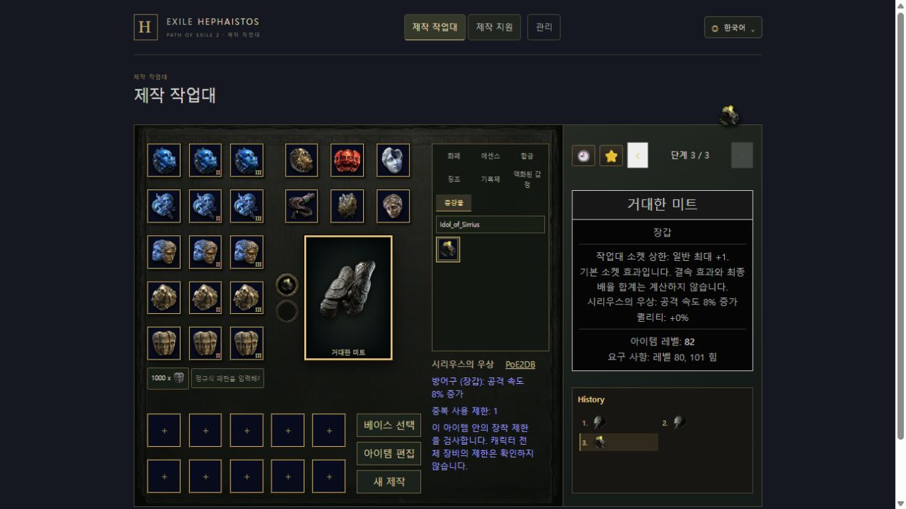

# 일반 Augment 확장 검증

작업 branch는 `codex/augment-catalog-expansion`, 기준은 `ceab37535c2ae8fcb3b3432b65bbb822b7a35ace`다. 원본 UI checkout 및 다른 갈래는 수정하지 않았다. 이 갈래는 기능 commit만 제공하며 merge·push·운영 반영은 수행하지 않는다.

## 구현 결과

- 원문 313종 전수 대조. 기존 79종 보존, 일반 198종 추가로 총 277종 등록·232종 신규 선택.
- 추가 종류: Rune 129, Idol 33, Soul Core 32, Abyssal Eye 4. 항목별 전체 목록은 [대조표](../../current/augment-catalog-audit.md), 원문과 상태별 근거는 [audit.json](../../evidence/0.5.5/augment-expansion-20261105/audit.json).
- 특수 동작 23종은 사용자 지시로 보류. Sceptres/Foci 전용 5종은 홈 자격·상한 미검증, DNT-Unused 8종은 일반 효과 없음.
- 같은 아이템의 중복/공유 그룹 제한과 교체 슬롯 검증 적용. 캐릭터 전체 장비 제한은 검사하지 않으며 툴팁에 명시.
- 기존 제한 누락 Soul Core 9종의 저장 상태는 읽기·일반 제작에서 보존하되 새 장착은 제한. 기존 Perfect 선택 정책·Tempered 구성·하위 등급 기록·즐겨찾기·관측 정보 보존.
- 6개 언어 이름·기본 효과·원문 제한, 출처 URL, 원본 아이콘 277개와 SHA-256 연결. URL 인코딩 ID의 실제 이미지 HTTP 경로까지 확인.
- ItemState 스키마·소켓 frame art·소켓 위치·접사/품질/확률 엔진은 변경하지 않았다. 표시한 전투·캐릭터 조건부 효과의 최종 합계와 Bonded는 계산하지 않는다.

## 통과한 검사

- Backend: Augment·ruleset·ArchUnit 13개, Docker 통합 8개, Spotless, migration을 적용한 임시 PostgreSQL에서 `generateJooq`, `bootJar`.
- Frontend: `npm ci`, lint, typecheck, format:check, build. 영향 테스트 189개, 마지막 helper 검증 6개.
- Python: 원문 6개 언어 재파싱·대상 대응·원래 값 보존·이미지/원문 hash 및 Windows 개발 스크립트 13개.
- Git staging 후 sealed resource 604개·원문 HTML 18개·아이콘 277개의 실제 Git blob SHA-256 일치 확인. 최종 JAR의 카탈로그·manifest도 검증한 파일과 바이트 단위로 일치.
- API: [api.json](api.json). 등록 베이스 179개 중 지원 94개, 신규 선택 장착 조합 961개, 제한 190종과 기존 Soul Core 9종, 2,911회 요청 통과. 아이콘 HTTP 응답·원본 hash 277개 통과.
- 화면: [ui.json](ui.json). 신규 Idol 장착, 중복 제한, Ancient 공유 제한·같은 그룹 교체, 한국어/English/简体中文/繁體中文/日本語/Español 이름·효과·제한, 이전/다음 기록 복원 확인.

## 전체 검사 한계

Frontend 최초 전체 실행은 3,009개 중 14개 실패했다. 카탈로그 수 변경 3개와 실제 변경한 CraftingPage의 출처 hash 1개는 갱신 후 영향 검사에서 통과했다. 동시 실행 중 시간 초과가 난 Layout 검사도 단독 영향 검사에서 통과했다. 남은 입력 취소 focus 8개와 Sapphire 1개는 기준 commit의 `git archive` 사본에서도 재현했다. 필요한 contracts·Backend 정책을 누락했던 초기 사본의 수집 실패는 기준선 재현으로 세지 않았다. 이 갈래에서 해당 기능의 기대값이나 구현을 수정하지 않았다.

Backend 전체 `check generateJooq bootJar --continue`는 17분 14초 실행했지만 완주하지 않았다. 15분 이상 실행 중이던 변경하지 않은 `DeferredCalculationTest.internalOrbitMixturesMatchEveryConcreteMethodAndRestoreOriginalGraphCells`에서 소유 경로를 확인한 이 갈래의 test worker만 종료했다. 종료 전 로그는 763개 완료·12개 실패·1개 중단/skip을 보고했다. 관측된 실패 12개는 [이전 기준선 재현 기록](../socket-augments-20261105/checks.json)의 항목과 일치하며, 이번 갈래에서 Backend 기준선 전수를 다시 실행한 것은 아니다. 이후 최종 코드에 대해 위 Backend 영향·통합·생성·빌드 검사를 별도로 통과했다. 전체 검사를 통과했다고 주장하지 않는다.

구체적인 명령·결과·분류는 [checks.json](checks.json)에 있다. 일반화된 테스트 skip이나 기대값 완화는 추가하지 않았다. 검증 서버는 전용 19510/19511, DB/Redis는 전용 19532/19579를 사용했으며 기존 volume을 연결하지 않았다.

검증 후 listening PID·명령줄·컨테이너 label을 확인한 전용 서버·컨테이너와 해당 익명 테스트 volume을 정리했다. 다른 서비스는 변경하지 않았다.

## 통합 시 확인할 파일

- `CraftingPage.tsx`: 실제 슬롯을 넘기는 `canInstallAugment` guard를 UI 갈래가 이동한 소켓 컴포넌트에도 유지한다. 이 파일의 변경은 import와 guard뿐이다.
- `socketAugments.ts`: `canInstallAugment(state, id?, slot?)`는 슬롯 생략 시 가능한 슬롯을 검사한다. 새 제한과 과거 상태 보존을 함께 유지한다.
- `gameTerms.json`: locale/ID별로 병합한다. 기존 항목의 값은 변경하지 않았다.
- `ruleset-v1.json`: 모든 갈래를 통합한 뒤 `node scripts/update-ruleset-manifest.mjs`로 실제 최종 자원의 digest를 재생성한다. 과거 기록의 identity를 새 값으로 바꾸지 않는다.
- `chaos-repeat/display/goldens/sources.json`: 최종 병합된 CraftingPage의 SHA-256만 다시 계산한다. display expected 값은 수정하지 않았다.
