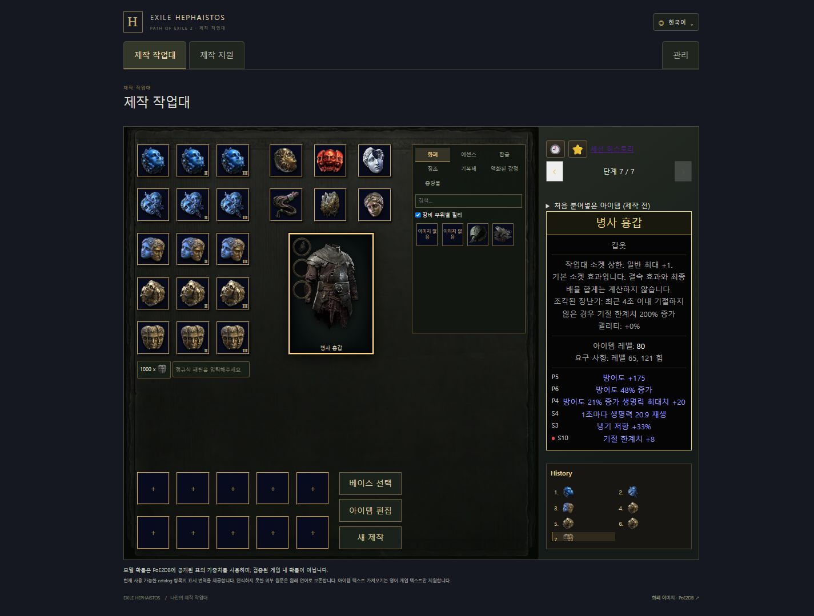

# 네 갈래 통합 검증 · 2026-11-05

공통 기준은 `ceab37535c2ae8fcb3b3432b65bbb822b7a35ace`, 통합 branch는 `codex/four-way-integration-20261105`다. 전용 614e worktree에서 병합·검증했다. 기능 개발을 중복하지 않고 각 갈래의 commit과 원문·검증 자료를 보존했다.

## 반영 이력과 자체 리뷰

| 갈래 | 보존한 최종 commit |
|---|---|
| 필터·헤더·소켓 위치·기본/활성 강조 | `0d3fe1d92ecd60a171ad7c40f632367c1dfc0e7b` (`9b0ba5d9`, `7ee8a04c` 포함) |
| 아이템 텍스트 양방향 갱신 | `f1168b9a2fe178311ee474489ce47753667634d4` |
| 별도 세션 히스토리·JSON·PNG·서버 공유 | `1752dc39bc0263ae80537b2af17712daa980e705` |
| 일반 Augment 확대·아이템 내 장착 제한 | `b1510d5387da27ac1d22b21b01e3f49f771939be` |

병합 기록은 `4aeed0d2`, `7eacafeb`, `077b94a5`, `a54a35b8`이다. CraftingPage의 입력 요청 잠금·소켓 focus 복귀·베이스 필터·히스토리 진입을 함께 유지했다. 표시 source hash는 병합된 실제 파일로 Frontend/Backend 양쪽을 갱신했고, 표시 기대값은 바꾸지 않았다.

`canInstallAugment(state, id?, slot?)`의 슬롯 생략 경로와 실제 교체 슬롯의 제한을 모두 보존했다. 이동된 SocketAugmentSlots에도 슬롯별 활성·클릭·drop guard를 연결했다. Ancient 공유 그룹의 기존 슬롯 교체만 허용하는 회귀 검사를 추가했다. 신규 히스토리 카드의 소켓 개수는 고정 `/1` 표시를 사용하지 않는다.

테스트 데이터 수정 두 건은 별도로 검토했다. 일반 Augment 신규 선택 수는 검토된 카탈로그의 232개다. 베이스 필터 UI 검사의 `solar` 임시 ID는 분류를 알 수 없는 legacy로 해석되므로, 실제 등록 ID `Metadata/Items/Amulets/FourAmulet9`를 사용하도록 고쳤다. 미분류 legacy의 재료를 숨기지 않는 정책과 실제 베이스 선택/복원 후 Catalyst 필터 기대값 1개는 그대로 유지했다.

과거 Film의 원문·ruleset identity는 새 값으로 바꾸지 않았다. 보류된 특수 Augment 동작·미지원 Sceptres/Foci·DNT 항목은 확대하지 않았다.

## 자동 검사

| 검사 | 결과 |
|---|---|
| npm ci | 정상 환경에서 완료, 의존성/잠금 파일 변경 없음 |
| lint / typecheck / format:check / production build | 통과, 최종 테스트 수정 후 lint/format 재확인 |
| Frontend 전체, 단일 worker | **3,045개 중 3,042개 통과·3개 실패**, 수집 실패 없음 |
| 마지막 Frontend 영향 검사 | 7개 파일 **63개 통과**, 실패/skip 없음 |
| 입력 취소 focus 회귀 | 기존 8개 모두 전체 실행과 최종 영향 검사에서 통과 |
| Backend 영향 검사·ArchUnit·표시 hash | 15개 XML suite, **231개 통과**, 실패/skip 없음 |
| Docker 통합 검사 | 2개 XML suite, **8개 통과** |
| Spotless / generateJooq / bootJar | 통과. migration을 적용한 임시 DB만 codegen에 사용 |
| sealed resource / Augment mirror / 표시 source | 604개 digest와 19개 표시 hash 검증, 양쪽 mirror 일치 |

Frontend 전체 3개 실패 중 Sapphire는 기존 실패다. 나머지 선택 수와 임시 베이스 ID 문제는 위 수정 후 영향 검사에서 통과했다. 전체 실행 결과와 수정 후 영향 결과를 합쳐 새로운 전수 통과 수치를 만들지 않았다. [전체 결과](frontend-full.json), [최종 영향 결과](frontend-focused.json).

최초 Frontend 실행은 격리 환경의 임시 client 파일 ENOENT로 177개 파일 수집에 실패해 실제 테스트가 0개였다. 이를 기능 실패/통과로 세지 않고 정상 실행 환경에서 전체 검사를 한 번 다시 실행했다. 이 환경 로그는 Git에 포함하지 않는 `backend/build/integration-verification/frontend-initial-environment.*`에 보존했다.

Backend 전체 `check generateJooq bootJar --continue`는 약 15분 뒤 기존 `DeferredCalculationTest.internalOrbitMixturesMatchEveryConcreteMethodAndRestoreOriginalGraphCells`에서 계속 계산 중임을 thread dump로 확인하고, 614e 경로의 전용 worker만 중단했다. Gradle 로그는 770개 완료·12개 실패·1개 중단/skip을 기록했고 전체 명령은 실패했다. **전체 Backend 검사는 미완료**다. 12개 실패 이름은 실제 로그에서 추출해 기존 socket-augments 검증 기록과 모두 대응했다. 중단 후 XML이 확정되지 않아 빈 XML 집계를 근거로 쓰지 않았다. [로그 기반 분류](backend-full.json), [별도 완료된 영향·통합 XML 집계](backend-focused.json).

일반 skip·timeout 확대·기대값 완화는 추가하지 않았다. Windows 실행 스크립트와 Compose 설정은 수정하지 않았다.

## 실제 화면과 API

Codex in-app browser의 새 검증 탭과 합성 공개 아이템만 사용했다. 기존 Chrome 접근 요청을 반복하지 않았고 사용자의 9001 브라우저 저장소를 조작하지 않았다. 검증 포트는 API 19410, production 미리보기 19411, 전용 PostgreSQL 19432, Redis 19479다.

- 텍스트 레벨 수정 → 상태 갱신, 제작 소켓/장착물 → 영문 텍스트 갱신, 수정 후 세 소켓과 신규 Ancient ID 보존.
- dirty 초안의 닫기/재열기·focus 복귀, 미해석 행 적용 차단·보존, 제작으로 상태가 바뀐 초안의 적용 차단.
- Ancient 교체의 슬롯별 활성·키보드 Enter, 기본 비활성 소켓과 중앙 이미지 안쪽 좌상단 배치, 부위 필터 ON/OFF.
- 8개 상태의 4열 ㄹ 모양·900px 2열·320px 1열, 기보 이름, JSON 미리보기/가져오기/새로고침 복원.
- 작업대와 히스토리 각각 기존 6개 언어, 320px에서 가져온 세션 복원과 소켓의 이미지 내부 배치.
- 서버 공유 링크가 로컬 Film을 아직 가져오지 않은 별도 origin에서도 실제 데이터를 조회. export Film과 서버 snapshot의 구조가 동일함을 API로 대조.
- PNG 두 장 생성·첫 장 다운로드. 최초 열린 화면의 한 클릭에서는 출력이 보이지 않았으나 새로 로드한 공유/가져온 페이지에서 재현되지 않았고 파일까지 확인했다. 원인을 확정했다고 주장하지 않는다.
- 전용 API 프로세스 재시작 후 snapshot의 정확한 바이트가 유지됨. 잘못된 ID/스키마/용량 초과의 오류 응답 확인.

[화면 확인 목록](ui.json) · [API 확인](api.json) · [PNG 첫 장](snapshot-1.png)

[320px 작업대](workbench-mobile.jpg) · [데스크톱 히스토리](history-desktop.jpg) · [320px 히스토리](history-mobile.jpg)

운영 갱신은 원본 checkout에서만 수행하며 `.env`·DB·Redis·app-data·사용자 기록을 보존한다. 외부 push나 공개 배포는 수행하지 않는다.

## 원본 반영과 최종 서버

원본 `C:\SSAFY\PYJ\PROJECT\Exile-Hephaistos\Exile-Hephaistos`가 `0d3fe1d9`에서 clean임을 재확인하고 전용 `codex/local-integrated-20261105` branch를 만들었다. 검증된 구현 commit `e4c65af06684be65a51f8c06de311b82b9625e9d`까지 fast-forward한 원본에서 Compose config의 quiet 검사와 app/frontend 빌드를 완료했다. `up -d --no-deps app frontend`로 두 서비스만 교체했다.

- 9000 readiness `UP`, 9001 HTML/production bundle 응답, 실제 작업대와 공유 페이지를 확인했다. 최종 bundle은 `/assets/index-EwDVAe6D.js`다.
- 배포된 API에서 새 Augment를 포함한 텍스트 편집과 소켓 보존을 다시 확인했다. 신규 아이콘의 HTTP 바이트도 원본과 일치했다.
- 기존 PostgreSQL `0c5febf25519`, Redis `ac679c135efc`는 동일 컨테이너다. 모든 mount와 `.env` 해시가 동일하고 모든 포트의 `127.0.0.1` 바인딩을 유지했다. 최초 보존 검사에서 PowerShell의 단일 배열 unwrap으로 형식 비교가 실패한 것은 양쪽을 배열로 정규화해 전체 mount를 다시 비교했다. 실제 volume 차이는 없었다.
- 갱신된 app만 한 번 재시작하고 readiness와 공유 snapshot의 정확한 바이트 존속을 확인했다. 재시작 전후 모든 컨테이너 ID가 동일했다. 실제 공유 화면은 8개 카드·catalog 경고 0개·PNG 2장·console 경고/오류 0개였다.
- 운영 검증으로 공개 합성 snapshot 2건을 추가했다. 기존 사용자 파일·세션·DB 데이터는 삭제하지 않았다. 원본 브라우저 저장소에는 합성 세션을 가져오지 않았다.
- 614e에서 생성한 검증 API/미리보기 PID와 DB/Redis owner label을 확인한 뒤 자신의 검증 자원만 정리했다. 19410/19411/19432/19479 포트가 모두 해제됐고 운영 네 컨테이너는 실행 중이다.

[최종 서버 식별 정보와 확인 목록](server.json) · [실제 9001 작업대](server-home.jpg) · [app 재시작 후 공유 히스토리](server-history.jpg)

이 마지막 서버 증거 추가는 문서·이미지만 변경하며 실행 코드는 `e4c65af0`과 동일하다.
