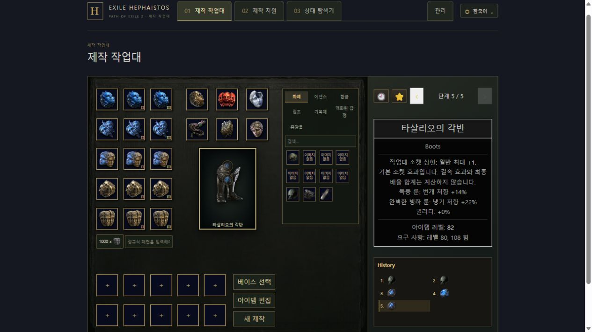

# 소켓·Augment 검증

기준 HEAD: `fbd0b9a50c454bd46aaafa557c06f9964701b263`. 구현 branch: `codex/workbench-sockets`.

## 구현과 지원

- 등록 179개 베이스 중 94개에 Workbench 소켓을 지원한다. 일반 상한에 추가 1개를 허용하는 사용자 정책이며 실제 게임에서 일반 Artificer's Orb로 이 상한까지 만들 수 있다는 주장이 아니다.
- 63종 Rune과 16종 Soul Core, 지원 장비 class별 1,023개 조합을 등록했다. Perfect Tempered Rune는 검토된 일반 효과 행이 없어 제외했다. Bonded·특수 Rune·캐릭터 전체 제한·추출·최종 전투 합계는 계산하지 않는다.
- 소켓 수와 장착 ID를 별도 상태로 검증한다. 장착·교체와 다른 화폐 적용 중 보존, 기존 기록의 복원과 규칙 경계를 연결했다. 새 export/import나 아이템 텍스트 양방향 갱신은 추가하지 않았다.
- 상세 지원 class·출처·미지원 경계는 [현행 명세](../../current/socket-augments.md)를 따른다.

## 최종 검증

| 검사 | 결과 |
|---|---|
| `npm ci` | 통과, 잠금 파일 변경 없음 |
| Frontend lint / typecheck / format:check / build | 통과 |
| Frontend 전체 Vitest, 단일 worker | 2,996개 중 2,987개 통과. 기존 포커스 8개와 Sapphire 1개 실패 유지 |
| Frontend 최종 집중 검사 | 168개 통과. 앞선 전체 실행의 일시적 Chaos 요청 경합 실패도 재검증에서 통과 |
| Backend 변경·직접 영향 영역 | 134개 통과 |
| Backend 최종 provenance / catalog seal / SocketAugments / ArchUnit | 124개 통과 |
| Docker 통합 검사 | 8개 통과. 새 필드 생략으로 발생했던 422는 strict reader의 하위 호환 처리로 수정 |
| `generateJooq`, `bootJar`, Spotless | 통과. codegen은 migration을 적용한 임시 PostgreSQL에서 실행 |
| 실제 API | 1,570건 통과. 179개 등록 베이스의 자격과 94개 지원 베이스의 상한, 79종의 1,023개 장착 조합, 교체·일반 제작 보존·위조 입력 거절 |

요청한 전체 Backend 명령 `gradlew.bat check generateJooq bootJar --continue --max-workers=2`도 실행했다. 해당 전체 unit 실행은 1,423개 중 55개 실패로 종료했다. 이 가운데 새 소켓 지원·추가 필드·카탈로그 개수·화면 코드 출처 hash에 관계된 18건은 계약과 provenance를 갱신한 후 위 최종 집중 검사에서 통과했다. 나머지 37건은 기준 HEAD 생산 Java 소스와 원래 봉인 리소스를 `build/socket-baseline`에 임시 컴파일하여 동일하게 재현했다. 자동 탐색·저장 재개·역사적 digest 기준선의 기존 실패이며 원본 테스트의 기대값이나 skip으로 숨기지 않았다. 전체 검사가 모두 통과한 것으로 보고하지 않는다.

Basic currency의 이전 결과 hash는 장착 목록이 비어 있음을 별도로 검증한 뒤 추가 필드만 기존 투영에서 제외하여 그대로 비교한다. 수치·이벤트·가정·난수 순서의 기대 hash는 바꾸지 않았다. 프런트와 Backend의 공통 display source manifest를 동기화했으며 표시 결과 goldens는 바꾸지 않았다.

원시 전체 결과의 집계와 기준 HEAD 재현 테스트 목록은 [checks.json](checks.json), API 집계는 [api.json](api.json)에 있다.

## 화면 확인

기존 9000/9001 서비스를 보존하고 별도 19010/19011 포트, 임시 PostgreSQL·Redis에서 확인했다.

1. Tasalian Greaves를 놓고 Artificer's Orb로 `0→1→2`를 확인했다.
2. 첫 슬롯 Desert Rune의 화염 저항 +14%, 두 번째 Perfect Glacial Rune의 냉기 저항 +22%가 별도 효과로 표시됐다.
3. 첫 슬롯을 Storm Rune으로 교체해 번개 저항 +14%로 바뀌고 두 번째 슬롯이 보존됐다.
4. 새로고침 후 두 장착물·효과·기존 단계가 복원됐다. 세 번째 오브는 상태를 바꾸지 않고 거절됐다.
5. 390×844 viewport에서 가로 overflow 없이 슬롯과 재료 탭을 확인했다. 슬롯의 접근 가능한 이름과 원래 언어별 재료 이름이 연결됐다.

[좁은 화면 캡처](narrow.png)

화면·API 검증용 서버, 임시 DB·Redis 컨테이너, 별도 Gradle 캐시 볼륨을 정리했다. 기존 앱·DB·Redis 서비스와 기존 데이터·볼륨은 보존했다. 푸시·외부 배포·운영 서버 업데이트는 수행하지 않았다.
