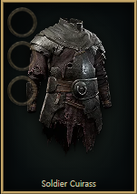
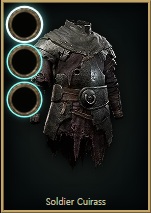
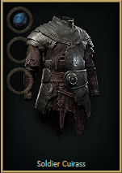

# 소켓 안쪽 배치·추가 강조와 부위 필터 보완

2026-11-05. 기준 `9b0ba5d96151acbd6b2c11febb44741b7eee789b`, 구현 `7ee8a04c5716212af7b8e1485c4a004ed09d3073`, branch `codex/socket-inside-active-state`. 이전 소켓 `ceab3753`와 최신 헤더·부위 필터를 포함한 원본 작업 공간에서만 작업했다.

## 결과와 자체 리뷰

- 소켓을 중앙 아이템 이미지 네모 **안쪽 왼쪽 위**에 세로 배치했다. 금속 테두리·검은 내부 자산과 Rune 아이콘은 그대로 사용한다. 기본 아이템 테두리를 기존 선택 상태의 금색으로 하고, 소켓 밝기를 기존 hover 수준으로 유지한다.
- 현재 부위·소켓·Perfect 선택 정책·일반 검증 상태가 맞고 요청 중이 아닐 때만 청록 윤곽·빛을 추가한다. 드롭 대상은 더 강하게 강조한다. animation을 추가하지 않아 reduced-motion에서도 깜빡이지 않는다. 비활성·Escape·드래그 종료·취소·요청 중에는 추가 강조를 제거한다.
- `SocketAugmentSlots`는 중앙 아이템 버튼의 형제다. 같은 클릭이 중앙 아이템과 슬롯에 중복 적용되지 않는다. drag payload와 들고 있는 ID가 일치할 때 해당 슬롯만 장착·교체한다. 키보드 교체 후 focus는 DOM의 요청 잠금 해제가 반영된 뒤 중앙 아이템으로 복귀한다.
- Essence/Alloy 표시에는 보존된 영어 툴팁의 대상 분류와 등록 부위의 포함관계를 사용한다. 예를 들어 갑옷에는 Body Armour 전용과 Armour 공통 Essence가 함께 나타난다. 표시용 타입과 현재 희귀도·옵션·실행 가능성은 분리하며 실제 API 검증을 넓히지 않았다. Catalyst/Liquid는 기존 베이스/catalog 메타데이터를 유지한다. 분류 미상 구버전 ID를 추측해 숨기지 않는다.
- Rib/Jawbone/Collarbone/Cranium과 방어구/무도 무기 품질 화폐를 부위별로 표시한다. Omen 예외와 전역 Perfect/미지원 재료 선택 정책은 유지한다. 검색 아래의 6언어 체크박스로 타입 필터만 켜고 끄며 검색어는 보존한다.
- Essence 특수 재료 우선과 가족 검색을 유지하면서 빈 placeholder를 없애고 4열을 앞에서부터 채운다. 초기 실제 베이스 선택 전에는 전체 목록을 유지한다. 즐겨찾기·장착·기록은 삭제·변환하지 않았다.

표시 분류와 원문 효과를 재사용했으며 게임 확률·효과·tier·weight, Backend 실행 로직, API schema, migration, 의존성·잠금 파일은 바꾸지 않았다. 2·3번 텍스트/히스토리 및 추가 Augment 갈래는 구현하거나 병합하지 않았다.

## 검증

| 검사 | 결과 |
|---|---|
| `npm ci` | 통과. 실행 중이던 이 작업의 Vite를 닫아 Windows DLL 잠금을 해제한 뒤 완료 |
| lint / typecheck / format:check | 최종 소스 통과 |
| Frontend 직접 영향 16개 파일 | 282개 중 281개 통과, 메뉴 동선 한 건 5초 시간 초과. 해당 한 건 개별 재검사 통과 |
| 기존 메뉴 한 건 개별 재검 | 1개 통과. timeout/skip/기대값 완화 없음. [menu-rerun.json](menu-rerun.json) |
| Backend `FrontendOptionGoldenTest` | 115개 통과. 변경된 UI source hash와 기존 표시 수치 계약 검증 |
| 번역 범위 검사 | 6언어, 각 220개 활성 이름과 2,960개 catalog 정의 통과 |
| 로컬 build / Docker Frontend build | 통과 |
| 반영된 서버 소켓 실제 화면 | 198개 통과. [checks.json](checks.json) |
| 반영된 서버 타입 필터 실제 화면 | 34개 통과. [filter-checks.json](filter-checks.json) |

[unit-summary.json](unit-summary.json)은 범위 검사 원래 집계와 시간 초과를 그대로 보존한다. 개별 재검은 별도 기록이다. 기존 전체 suite 실패를 숨기거나 전체 검사가 통과한 것으로 보고하지 않는다. 이번 변경은 Frontend와 표시 source provenance에 한정되어 전체 Backend `check generateJooq bootJar`, DB 통합 검사와 전체 Frontend suite는 재실행하지 않았다. 직접 영향 범위는 실제 장착·교체·기록 복원·기존 제작·검색·레이아웃·부위 필터·6언어를 포함한다.

6개 언어 각각 데스크톱 1440px와 320px에서 기본/드래그/장착/교체/비활성/취소/focus/새로고침 복원을 확인했다. 별도 320px 터치 context에서 탭 선택·장착도 확인했다. 합성 공개 아이템을 fresh browser context에서만 사용했다.

필터 검증은 실제 베이스 저장과 화면 전환을 기다린 뒤 실행한다. 갑옷의 Normal→Magic→Rare에서도 같은 타입 목록이 유지됐고, Armour 공통/Body 전용 Essence, Bow/Wand/Amulet의 심연·품질 화폐, Omen 예외, 토글·툴팁 검색 조합과 두 화면 크기의 빈칸 없는 배열을 확인했다. 베이스 선택의 기존 hover 미리보기가 footer를 가리는 경우에는 footer focus로 닫은 뒤 선택했다.

## 반영과 기존 서버 복구

구현 커밋 후 사용자의 요청대로 다른 갈래를 기다리지 않고 `docker compose --env-file .env -f infra/compose.yaml --profile stack up -d --no-deps frontend`로 9001을 교체했다. 최종 API health `UP`, UI 200, 준비한 Frontend image와 제공 소켓 자산 해시 일치를 확인했다. 최종 스크린샷과 두 실제 검사 JSON의 origin은 모두 9001이다. [server.json](server.json)

작업 중 기존 네 컨테이너가 종료된 상태를 발견했다. Docker 이벤트에는 15:07 KST경 kill/stop과 신호가 있었고 OOM 플래그는 false였다. 누가 중지했는지는 확인하지 못했으며 원인을 단정하지 않았다. 기존 DB·Redis를 같은 컨테이너로 시작하고 의존 서비스 준비 후 같은 앱을 시작해 먼저 복구했다. 앱·DB·Redis ID와 volume을 유지했으며 초기화·삭제·전체 down/prune를 하지 않았다. [recovery.json](recovery.json)

최종 교체는 Frontend만 수행했다. 앱·DB·Redis는 기존 ID 그대로 running이다. 다른 갈래의 worktree·임시 서비스·데이터는 변경하지 않았다. 이 작업의 19411 미리보기만 종료했다. push·외부 배포·master 병합은 하지 않았다.

## 실제 화면

| 기본 | Rune 드래그 | 장착 |
|---|---|---|
|  |  |  |

[데스크톱 전체](en-1440-screen.png) · [한국어 320px](ko-320-screen.png) · [터치](touch-320.png) · [갑옷 필터](filter-body-desktop.png) · [320px 필터](filter-body-320.png)

나머지 각 언어의 기본/드래그/장착 캡처도 같은 폴더에 보존한다.
