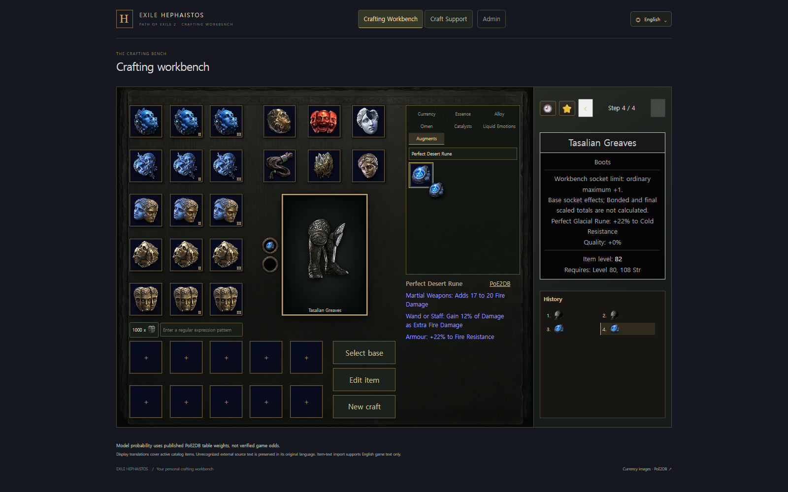

# 소켓 참조 이미지·Rune 선택 정책·그룹 툴팁

2026-11-05. 기준 HEAD `740bbe9c3eebee60fef1a9b0d540d735127aa2c7`, 작업 branch `codex/socket-reference-perfect-runes`.

## 구현과 자체 리뷰

- 사용자 제공 107×107 이미지에서 built-in imagegen으로 금속 테두리와 검은 내부를 포함한 소켓 자산을 추출·정제했다. 바깥만 투명하다. [최종 자산](../../../frontend/public/assets/augments/socket-frame.png), [원본·자산 SHA-256 및 최종 생성 지시](../../../frontend/public/assets/augments/socket-frame.source.json)를 보존한다. 원본의 작은 해상도 때문에 생성 도구를 통한 정제가 포함됐으며 원본 픽셀 그대로의 crop은 아니다.
- 중앙 아이템 칸 왼쪽에 소켓을 세로 배치했다. 모바일에서 인접 화폐와 겹치지 않도록 크기·간격을 조절했다. 장착 이미지·접근 가능한 슬롯 이름·교체·최대 3개 소켓을 유지했다. Enter 교체 후 비활성 소켓에 focus가 남으면 중앙 아이템으로 복귀한다.
- 검토된 Perfect 일반 효과가 있는 15개 Rune 계열만 Perfect-only로 제한했다. Tempered 3종과 Soul Core 16종을 유지해 새 선택 대상은 34종이다. 기존 79개 ID와 원문 효과는 보존하며 과거 장착·저장 기록을 삭제·변환하지 않는다. Frontend 선택/검색/즐겨찾기와 Backend 새 장착 자격에 같은 정책을 적용했다.
- [PoE2DB Rune](https://poe2db.tw/kr/Rune)에서 확인한 무도 무기 / 마법봉 또는 지팡이 / 방어구 구분으로 피드백을 묶었다. 같은 효과를 중복 표시하지 않으며 서로 다른 효과·번역과 일부 부위에만 있는 효과는 부위 한정을 보존했다. 장신구 효과를 새로 만들지 않았다. 표시한 그룹명도 검색 가능하다. 6개 언어와 출처 링크를 유지했다.
- 목록 필터와 저장 상태 검증을 분리했다. 새 ruleset digest를 봉인 manifest와 source fixture에 반영했고 기존 기록의 identity를 재라벨링하지 않았다. 수치·display goldens·과거 이력은 수정하지 않았다.

## 검증

| 검사 | 결과 |
|---|---|
| `npm ci` | 통과. 앱 의존성·잠금 파일 변경 없음 |
| Frontend lint / typecheck / format:check | 통과 |
| Frontend build / Docker Frontend build | 통과 |
| Frontend 전체 Vitest, 최종 소스 4 workers | 3,008개 중 2,999개 통과, 기존 실패 9개 유지 |
| Frontend 직접 영향 검사 | 204개 통과. 추가 그룹명 검색·부분 부위 표시도 별도 재검증 통과 |
| Backend 소켓·카탈로그 봉인·Workbench·ArchUnit·display source | 147개 통과 |
| 최종 UI source hash 반영 후 Backend 소켓·ArchUnit·display source 재검증 | 121개 통과 |
| 전체 Docker 통합 검사 | 8개 통과 |
| `generateJooq`, `bootJar`, Spotless | 통과. codegen은 migration을 적용한 임시 PostgreSQL 사용 |
| Compose `config --quiet` | 통과. 비밀값 출력 없음 |
| 실제 브라우저·API | 100개 통과. [checks.json](checks.json) |

Frontend 전체 검사 최종 집계는 [frontend-summary.json](frontend-summary.json)에 기록했다. 기존 ItemTextImport focus 8건과 Sapphire 상태 검증 1건은 선행 검증에서도 확인된 실패이며 기대값 완화나 skip으로 숨기지 않았다.

전체 Backend `check generateJooq bootJar --continue`도 실행했지만, 기존 `StrictExaltedScenarioTest`의 자동 탐색 시나리오가 장시간 계산 중이어서 중단했다. 중단 전 `BaseRegistryParityTest`, `EmptyRareApiRegressionTest`, `TerminalContinuationApiTest`에서 확인한 실패는 [선행 기준선 재현 기록](../socket-augments-20261105/checks.json)에 포함돼 있다. 전체 Backend 검사 통과로 보고하지 않는다. 위 직접 영향 검사·통합 검사·codegen·배포 빌드는 별도로 완료했다.

## 실제 화면

검증은 합성 공개 베이스만 사용한 별도 브라우저 context에서 수행했다. 개인 clipboard와 기존 browser storage를 읽거나 변경하지 않았다. Rune의 장착·교체, keyboard focus, 새로고침 후 복원, 모바일 가로 overflow와 화폐 겹침 없음, 최대 3개 소켓 배치를 확인했다.

[한국어 그룹 피드백](korean-feedback.png) · [모바일](mobile.png) · [3소켓 모바일](mobile-three-sockets.png) · [소켓 확대](socket-detail.png)

## 로컬 서버 반영

사용자의 “다하면 서버에 반영까지” 요청에 따라 기존 PC의 localhost 9000/9001 앱·Frontend를 교체했다. `docker compose --env-file .env -f infra/compose.yaml --profile stack up -d --no-deps app frontend`를 사용했으며 DB·Redis·기존 volume은 보존했다. 외부 서버 배포·master merge·push는 수행하지 않았다.

반영 후 API health `UP`, 실제 제공 소켓 PNG의 SHA-256 일치, 실제 9000/9001 대상 브라우저·API 검증 100개 통과를 확인했다. 위 화면과 [checks.json](checks.json)은 최종 반영된 서버에서 다시 얻은 결과다. [server.json](server.json)에 앱·Frontend의 새 image와 DB·Redis 컨테이너 동일성을 기록했다. 19010/19011 검증 서버와 이 작업에서 만든 임시 DB·Redis·검증용 Gradle volume은 정리했다.
